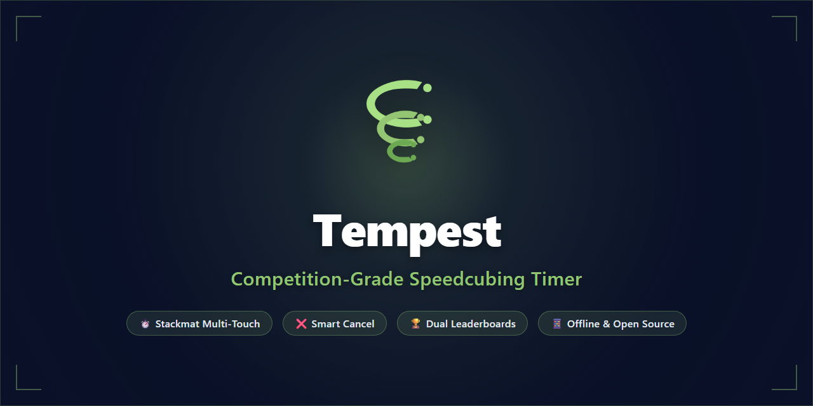

<p align="center">
  
</p>

<h1 align="center">Tempest</h1>

<p align="center">
  <strong>Competition-Grade Speedcubing & Rubik's Cube Stackmat Timer</strong><br />
  Built with Flutter • Offline-First • Multi-Touch Telemetry • Dual Stateful Leaderboards
</p>

<p align="center">
  <a href="https://github.com/ZeroNeroIV/Tempest/releases/latest">
    
  </a>
  <a href="https://github.com/ZeroNeroIV/Tempest/actions/workflows/build.yml">
    
  </a>
  <a href="LICENSE">
    
  </a>
  <a href="https://flutter.dev">
    
  </a>
</p>

<p align="center">
  
  
  
  
  
</p>

<p align="center">
  <a href="https://zeroneroiv.github.io/Tempest/">
    
  </a>
  <a href="https://github.com/ZeroNeroIV/Tempest/releases/latest">
    
  </a>
</p>

<p align="center">
  
</p>

---

## ⚡ Overview

**Tempest** is a modern, high-precision speedcubing timer designed for cubers who demand authentic competition-feel practice. Featuring hardware-grade Stackmat two-hand multi-touch timing with cancellation mechanics, multi-user tracking, dynamic event profiles, dual stateful leaderboards, and celebratory animations, Tempest brings a sleek, distraction-free experience to speedsolving.

---

## ✨ Features

### ⏱️ Stackmat Multi-Touch & Keyboard Desktop Timing
- **Two-Hand Stackmat Emulation**: Touch both pads on touchscreen devices, or hold **`[Z]`** (Left Hand) + **`[M]`** (Right Hand) on desktop & web.
- **Arming States**: Hold for $\ge 300\text{ms}$ (Amber holding $\rightarrow$ Pistachio green ready).
- **Instant Start**: Monotonic millisecond-precision timer starts precisely when both hands leave the screen or keys are released simultaneously.
- **Cancel Start**: Lift one hand while keeping the other down to cancel the start without triggering a false clock.
- **Instant Stop**: Tap anywhere on screen or slap any key (**`[Z]`**, **`[M]`**, **`[Space]`**) to lock your solve time immediately.
- **Spacebar Quick Mode**: Hold **`[Space]`** to arm both hands simultaneously on desktop.
- **Distraction-Free Fullscreen Mode**: Dedicated fullscreen toggle (`[F]` key or button) displaying only the high-contrast digits and Left/Right handpads (exit via **`[Esc]`**).

### 👥 Multi-User Management & Instant Switching
- **Top Avatar Bar**: Switch between cubists with a single tap.
- **Manage Users Dialog**: Add, rename, switch, and remove profiles directly from the home screen.

### 🧩 Built-in & Custom Profiles
- Pre-configured WCA events: **3x3x3**, **2x2x2**, **4x4x4**, **5x5x5**, and **Pyraminx**.
- **Dynamic Profile Creator**: Add custom categories and non-standard puzzles with dedicated tracking.

### 🏆 Dual Stateful Leaderboards & Stats
- **Profile Leaderboard (Global)**: Ranks all local users by their single best time on the active puzzle, with Gold 🥇, Silver 🥈, and Bronze 🥉 podium badges. Supports toggling between **Best Order** *(Default)* and **Chronological Order**.
- **User History (Local)**: Complete solve log with timestamps, penalties (`+2`, `DNF`), and solve deletion.
- **Slide-out Summary**: Automatically slides in after every solve with your new rank and record highlighted.

### 🎉 Dynamic Celebrations
- **Personal Best (PB)**: Confetti particle explosion and celebration banner.
- **Profile Record**: Flying golden trophies 🏆 emerging upwards from the bottom of the screen.

### 🎨 Clean Aesthetic & Customization
- **Theme Palette**: Dark Navy (`#0A1128`) & Pistachio Green (`#93C572`).
- **Corner Style Toggle**: Switch seamlessly between **Rounded** (smooth organic curves) and **Sharp** (clean geometric brutalist edges).
- **Light & Dark Mode**: True dark mode for AMOLED battery saving and crisp light mode for daylight practice.

---

## 🛠️ Architecture & Tech Stack

- **Framework**: [Flutter](https://flutter.dev) (Dart 3)
- **Design Philosophy**: SOLID & Feature-Driven Architecture
- **Modularity**: Strict code health enforcement — every file is under 400 lines of code.
- **Storage**: Offline-first local storage using `shared_preferences` and strongly-typed JSON models.
- **CI / CD**: Multi-platform automated GitHub Actions workflow building and publishing releases across 5 operating systems on every semver tag.

---

## 📦 Multi-Platform Releases & Downloads

Every push automatically builds, tests, and releases packages for all major operating systems:

| Platform | Format | Release Asset | Description |
| :--- | :--- | :--- | :--- |
| **Android** | `.apk` | `Tempest-*.apk` | Signed release APK ready for direct install or F-Droid |
| **iOS** | `.ipa` | `Tempest-*.ipa` | Sideloadable IPA (AltStore, Sideloadly, TrollStore) |
| **Linux** | `.AppImage` | `Tempest-*.AppImage` | Standalone portable executable for all Linux distributions |
| **Windows** | `.msi` | `Tempest-*.msi` | Windows Installer with standard installation wizard |
| **Windows** | `.exe` / `.zip` | `Tempest-*.exe` / `.zip` | Portable standalone Windows executable and runtime bundle |
| **Web** | Web App | [zeroneroiv.github.io/Tempest](https://zeroneroiv.github.io/Tempest/) | Live instant web app hosted on GitHub Pages |
| **Web** | `.zip` | `Tempest-*-web.zip` | Offline-first HTML5/Wasm web application bundle |

👉 **[Download All Platform Builds from Latest Release](https://github.com/ZeroNeroIV/Tempest/releases/latest)**

---

## 🚀 Getting Started

### Prerequisites

- [Flutter SDK](https://flutter.dev/docs/get-started/install) (3.13.5 or newer)

### Running Locally

```bash
# Clone the repository
git clone https://github.com/ZeroNeroIV/Tempest.git
cd Tempest

# Install dependencies
flutter pub get

# Run static analysis
flutter analyze

# Run unit & widget test suite
flutter test

# Run app on connected device or emulator
flutter run
```

---

## 👤 Author

**ZeroNeroIV (Alameen Mahmoud Mohammed Sabbah)**
- GitHub: [@ZeroNeroIV](https://github.com/ZeroNeroIV)
- Email: [alameensabbahj@gmail.com](mailto:alameensabbahj@gmail.com)

---

## 🤝 Contributing

Contributions are welcome! Please check out our [Contributing Guide](CONTRIBUTING.md) and [Code of Conduct](CODE_OF_CONDUCT.md).

1. Fork the repo.
2. Create your branch (`git checkout -b feature/cool-feature`).
3. Commit your changes (`git commit -m "feat: add inspection voice countdown"`).
4. Push to the branch (`git push origin feature/cool-feature`).
5. Open a Pull Request.

---

## 📄 License

Copyright (c) 2026 **ZeroNeroIV (Alameen Mahmoud Mohammed Sabbah)**.

This software is distributed under a **Non-Commercial License**.
- **Free for Personal & Educational Use**: You are free to view, download, compile, and use Tempest for personal practice, competitions, and non-commercial purposes.
- **Commercial Restrictions**: Commercial sale, sublicensing, monetization, or paid distribution without an explicit prior commercial license and royalty agreement with the author is strictly prohibited. For commercial licensing inquiries, contact [@ZeroNeroIV](https://github.com/ZeroNeroIV) or email [alameensabbahj@gmail.com](mailto:alameensabbahj@gmail.com).

See the [LICENSE](LICENSE) file for full legal terms.
